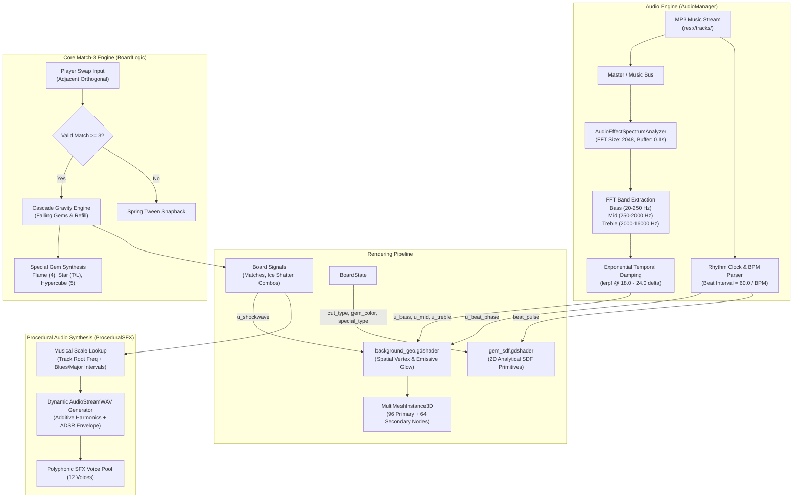

# Colored Time ⏱️💎

> **A synesthetic jazz-rhythm match-3 puzzle game where every swap grooves to the beat and shapes a living 3D luminescent world.**  
> *Developed for Godot 4.7+ (Forward+ Renderer, Jolt 3D Physics, Analytical GLSL Shaders, Real-Time Audio DSP)*

[](https://godotengine.org)
[](file:///Users/leonid/src/colored-time/shaders)
[](file:///Users/leonid/src/colored-time/scripts/core)
[](file:///Users/leonid/src/colored-time/tests)
[](https://github.com/godot-jolt/godot-jolt)

---

## 📑 Table of Contents
- [✨ The Experience](#-the-experience)
- [🎮 Game Modes](#-game-modes)
- [🕹️ How to Play & Controls](#-how-to-play--controls)
  - [The Rhythm Window: Swap on the Beat](#the-rhythm-window-swap-on-the-beat)
  - [Gravity Cascades & Musical Harmonics](#gravity-cascades--musical-harmonics)
  - [Assist Systems & Board Reshuffle](#assist-systems--board-reshuffle)
- [💎 Gem Arsenal, Powers & Hazards](#-gem-arsenal-powers--hazards)
  - [The 7 Gem Cuts](#the-7-gem-cuts)
  - [Special Power Gems](#special-power-gems)
  - [Board Hazards & Modifiers](#board-hazards--modifiers)
- [🎷 36-Track Soundtrack & The 6 Musical Worlds](#-36-track-soundtrack--the-6-musical-worlds)
  - [6 Style Archetypes](#6-style-archetypes)
  - [12-Tone Harmonic Color Wheel](#12-tone-harmonic-color-wheel)
- [⚙️ Under the Hood: Technical Architecture](#️-under-the-hood-technical-architecture)
  - [Core Pipeline Architecture](#core-pipeline-architecture)
  - [1. Real-Time 3D Spatial Audio-Reactive MultiMesh Stage](#1-real-time-3d-spatial-audio-reactive-multimesh-stage)
  - [2. Pure Analytical 2D Signed Distance Field (SDF) Gem Shaders](#2-pure-analytical-2d-signed-distance-field-sdf-gem-shaders)
  - [3. Multi-Layer Chrono Ice Blocker Shader](#3-multi-layer-chrono-ice-blocker-shader)
  - [4. Real-Time Audio DSP & Procedural SFX Synthesis](#4-real-time-audio-dsp--procedural-sfx-synthesis)
- [🚀 Quick Start & How to Run](#-quick-start--how-to-run)
- [🧪 Headless Test Suite & Engine Verification](#-headless-test-suite--engine-verification)
- [📁 Repository Structure](#-repository-structure)

---

## ✨ The Experience

**Colored Time** merges the addictive flow of classic jewel-matching puzzle games (*Bejeweled*) with the pulse of live jazz and reactive 3D visual synesthesia. 

Hovering over a floating 3D spatial stage, an 8×8 glass grid pulses with light and color. As an original 36-track jazz and blues soundtrack plays, the music doesn't merely loop in the background—it directly controls the universe:
- **Bass frequencies (20–250 Hz)** kick the camera FOV and physically deform geometric monoliths in real time.
- **Mid-range melodies (250–2000 Hz)** spin concentric gyro-rings and morph color harmonies.
- **High-frequency treble (2000–16000 Hz)** ignites sparkling rim highlights and grid edge shimmer.
- **Every match you make** synthesizes dynamic pitched chimes in tune with the track's musical key, ascending up blues and major scales with every cascade step.

---

## 🎮 Game Modes

### 🌟 36-Level Track Campaign
Embark on a musical journey through 36 hand-crafted tracks spanning bebop, swing, smoky ballads, and complex polyrhythmic blues.
- **Objective**: Fill the **Chrono Gauge** to 100% and shatter all **Chrono Ice** before the track finishes.
- **Score Target**: Reach the level's point goal through smart combos and on-beat multipliers.
- **3-Star Mastery**:
  - ★☆☆ **1 Star**: Clear the track (100% of target score).
  - ★★☆ **2 Stars**: Exceed target by 140%.
  - ★★★ **3 Stars**: Master the track by scoring 180%+ of target.
- **Progression**: Unlocks high score records, maximum cascade records, and rhythm accuracy statistics in persistent local storage.

### ♾️ Endless / Zen Mode
Lose yourself in uninterrupted jazz and puzzle flow.
- **No Timer / No Fail State**: Play at your own pace without pressure.
- **Seamless Progression**: Hitting the stage score target dynamically transitions to the next track in the catalog, continuously shifting the 3D visual archetype, musical key, and board atmosphere without interrupting your combo flow.

---

## 🕹️ How to Play & Controls

| Action | Control | Description |
| :--- | :--- | :--- |
| **Swap Gems** | **Click & Drag** or **Click Two Adjacent** | Swap any two horizontally or vertically adjacent gems to line up 3 or more of the same color. |
| **Snapback** | *Automatic* | Swaps that do not form a match smoothly snap back into place. |
| **Pause Menu** | **ESC** or **Pause Button** | Opens the centered modal to inspect score, resume, replay, or exit to the track carousel. |
| **Carousel Navigation** | **Left / Right Arrows** or **Track Cards** | Browse all 36 tracks, preview audio, inspect BPM, musical key, and stage archetypes. |

### The Rhythm Window: Swap on the Beat
In the center of the HUD, a **Beat Ring** contracts and expands with the rhythm clock (computed from the track's exact BPM).
- **On-Beat Window**: Swap within ±120 ms of the beat tick.
- **Bonuses**:
  - **1.5x Score Multiplier** on all points generated by that move.
  - **+5% Instant Chrono Gauge Boost**.
  - **Stage Shockwave**: Detonates an instantaneous radial distortion wave across the 3D background geometry.

```text
[ BEAT TICK ]  ───( ±120ms Window )───>  SWAP!  ───>  1.5x MULTIPLIER + 3D SHOCKWAVE 💥
```

### Gravity Cascades & Musical Harmonics
When gems match and clear, gravity immediately pulls remaining gems down while new procedural gems fall in from the top:
- **Chain Multipliers**: Consecutive chain reactions scale multipliers: 1× → 2× → 3× → 4× ...
- **Harmonic Chimes**: Every step of the cascade triggers a procedurally synthesized chime whose pitch steps up the track's musical scale (Blues or Major intervals). Deep cascades sound like an improvisational jazz solo!

### Assist Systems & Board Reshuffle
- **Idle Hints**: If no move is made for 5 seconds, the board gently highlights a valid swap.
- **Deadlock Reshuffle**: The engine continuously checks for possible moves. If zero valid swaps remain, the board automatically reshuffles all active gems while preserving active power gems and ice blockers—ensuring you never get trapped in a dead game.

---

## 💎 Gem Arsenal, Powers & Hazards

### The 7 Gem Cuts
Every gem is rendered using real-time analytical Signed Distance Fields (SDF) with facet refractions and inner bevels:

| Gem Name | Cut & Shape | Base Color | Visual Hierarchy |
| :--- | :--- | :---: | :--- |
| **Ruby** | Diamond / Octahedron | `#FF1E56` | Razor-sharp dual-pyramid crystal |
| **Amber** | Hexagon / Honeycomb | `#FFB800` | 6-sided beveled amber honeycomb |
| **Emerald** | Cushion / Square | `#00F5A0` | Rounded quadrilateral prism with mint glow |
| **Sapphire** | Trillion / Triangle | `#00D2FF` | 3-fold folding symmetry with refractive inner core |
| **Amethyst** | Cabochon / Circle | `#A855F7` | Smooth polished sphere with radial specular flare |
| **Pearl** | Radiant / Six-Point Star | `#F8FAFC` | Hexagram radiant intersection with brilliant white emission |
| **Obsidian** | Briolette / Teardrop | `#38BDF8` | Asymmetric teardrop cut (7th gem in advanced styles) |

### Special Power Gems
Create matching formations of 4 or 5 gems to forge explosive power gems:

| Special Gem | Formation | In-Game Effect | Points |
| :--- | :---: | :--- | :---: |
| 🔥 **Flame Gem** | **4-in-a-row** | Detonates a 3×3 fiery explosive area blast when matched, shattering gems and surrounding ice blockers. | **+400** |
| ⚡ **Star Gem** | **T-shape or L-shape** (5 gems) | Fires dual high-energy laser beams that clear the entire row and column simultaneously. | **+600** |
| 💎 **Hypercube (Chrono Prism)** | **5-in-a-row line** | Swapping with any adjacent gem obliterates **every gem of that color** across the entire board with a chromatic sub-bass blast. | **+1500** |

### Board Hazards & Modifiers
- 🧊 **Chrono Ice**: Frozen blockers that lock grid cells. Matching adjacent gems fractures the ice across multiple damage tiers until it shatters into sparkling shards (+300 pts).
- 🧩 **Procedural Board Masks**: Higher-difficulty stages feature customized board geometry—including corner cutouts, cross bottlenecks, and isolated chambers that test your matching strategy.

---

## 🎷 36-Track Soundtrack & The 6 Musical Worlds

Each of the 36 curated tracks belongs to one of 6 distinct musical and visual archetypes, each introducing unique BPM tempos, gem palettes, board masks, and procedural 3D scenery.

### 6 Style Archetypes

| Tracks | Archetype | Tempo (BPM) | 3D Visual Geometry Stage | Level Modifiers |
| :---: | :--- | :---: | :--- | :--- |
| **01 – 06** | `bird_blues` | 135 – 160 | Angular bebop prism tunnel & crystalline lattices | 6 gem colors, light Chrono Ice outer edges |
| **07 – 12** | `medium_swing` | 118 – 130 | Concentric swinging gyro-rings & floating ribbons | 6 gem colors, symmetric corner cutouts |
| **13 – 18** | `slow_ballad` | 72 – 84 | Floating crystalline monoliths & harmonic sine waves | 6 gem colors, relaxed beat window, deep cascades |
| **19 – 24** | `minor_blues` | 120 – 138 | Tessellated fractal pillars & hexagonal lattices | 7 gem colors, multi-layer Chrono Ice blocks |
| **25 – 30** | `burning_swing`| 185 – 210 | Kinetic wireframe vortex & spiral polyhedra | 7 gem colors, octagonal corner masks, fast tempo |
| **31 – 36** | `spiced_blues` | 130 – 152 | Chromatic torus knots & kaleidoscopic mandala shards | 7 gem colors, asymmetric board masks & ice locks |

### 12-Tone Harmonic Color Wheel
The musical key of each track maps to a specific hue on the chromatic color circle, dynamically dictating directional lighting, ambient environmental color, and 3D mesh tonality:

```text
C  (0.00 / Crimson Red)  ──>  G  (0.58 / Royal Blue)  ──>  D  (0.08 / Warm Amber)
A  (0.16 / Golden Yellow) ──>  E  (0.25 / Jade Green)  ──>  B  (0.33 / Emerald Mint)
F# (0.42 / Cyan Teal)     ──>  Db (0.50 / Cerulean)    ──>  Ab (0.66 / Deep Indigo)
Eb (0.75 / Royal Violet)  ──>  Bb (0.83 / Magenta)     ──>  F  (0.92 / Hot Pink)
```

---

## ⚙️ Under the Hood: Technical Architecture

### Core Pipeline Architecture

`Colored Time` couples deterministic board state resolution with a real-time reactive audio-visual rendering pipeline. Low-level digital signal processing (DSP) and high-frequency rendering are decoupled from turn-based puzzle state through event buses and shader uniform streaming:



---

### 1. Real-Time 3D Spatial Audio-Reactive MultiMesh Stage

*Source: [`shaders/background_geo.gdshader`](file:///Users/leonid/src/colored-time/shaders/background_geo.gdshader) & [`scripts/visuals/procedural_background_3d.gd`](file:///Users/leonid/src/colored-time/scripts/visuals/procedural_background_3d.gd)*

The 3D procedural stage renders two concurrent `MultiMeshInstance3D` systems (96 primary instances, 64 secondary instances) in Godot's Forward+ pipeline under ACES tonemapping and additive bloom (`glow_bloom = 0.25`, `glow_intensity = 0.8`).

#### Vertex Displacement Pipeline
Vertex position morphing is evaluated per-vertex on the GPU without CPU readbacks. Dynamic displacement scales with low-frequency audio energy and instantaneous board detonation shockwaves:

```glsl
void vertex() {
    // INSTANCE_CUSTOM packs: (phase_offset, speed_mult, amplitude, style_id)
    vec4 custom = INSTANCE_CUSTOM;
    v_custom = custom;
    float phase = custom.x + TIME * (0.5 + custom.y * 0.5) + u_beat_phase * 0.2;
    
    // Low-frequency Bass + match shockwave normal extrusion
    float disp = sin(phase * 4.0 + VERTEX.y * 2.0) * (0.05 + u_bass * 0.15 + u_shockwave * 0.2);
    VERTEX += NORMAL * disp;
}
```

#### Fragment Shading & Dynamic Emissive Bloom
Fragment emission is calculated through a hybrid model combining Fresnel view-angle falloff, rhythmic beat decay, treble sparkle perturbation, and shockwave propagation:

```glsl
void fragment() {
    vec4 custom = v_custom;
    float instance_id_norm = fract(custom.x * 3.14159);
    vec3 base_color = mix(u_primary_color.rgb, u_secondary_color.rgb, instance_id_norm);
    
    // Fresnel rim highlight
    float fresnel = pow(1.0 - clamp(dot(NORMAL, VIEW), 0.0, 1.0), 3.0);
    
    // High-frequency treble sparkle + bass pulse + shockwave surge
    float pulse = (1.0 - u_beat_phase) * u_bass * 1.5;
    float sparkle = u_treble * step(0.7, fract(custom.x * 17.0 + TIME * 3.0));
    float emit_strength = 0.2 + pulse * 0.8 + sparkle * 1.2 + u_shockwave * 2.5;
    
    ALBEDO = base_color * 0.4;
    METALLIC = 0.85;
    ROUGHNESS = 0.18;
    EMISSION = (base_color + vec3(fresnel * 0.8)) * emit_strength;
}
```

---

### 2. Pure Analytical 2D Signed Distance Field (SDF) Gem Shaders

*Source: [`shaders/gem_sdf.gdshader`](file:///Users/leonid/src/colored-time/shaders/gem_sdf.gdshader)*

Rather than relying on rasterized sprite textures, all gems are rendered **procedurally in screen-space** via analytical Signed Distance Functions. This yields infinite resolution scaling, perfect anti-aliasing via screen-space derivatives (`fwidth`), and dynamic procedural facet generation.

| Cut Type | Geometric Primitive | Mathematical SDF Formulation |
| :--- | :--- | :--- |
| **0: Diamond** | Rhombus / Octahedron | $d(\mathbf{p}, \mathbf{b}) = \text{length}\left(\mathbf{q} - 0.5\mathbf{b}(1-h, 1+h)\right) \cdot \text{sgn}(q_x b_y + q_y b_x - b_x b_y)$ |
| **1: Hexagon** | Regular Hexagon | $p'_x = \lvert p_x \rvert - 2\min(\mathbf{k} \cdot \mathbf{p}, 0)k_x;\quad d = \text{length}(\mathbf{p}') \cdot \text{sgn}(p'_y)$ |
| **2: Cushion** | Rounded Rectangle | $d(\mathbf{p}, \mathbf{b}, r) = \min(\max(d_x, d_y), 0) + \text{length}(\max(\mathbf{d}, 0)) - r$ |
| **3: Trillion** | Equilateral Triangle | Analytical 3-fold folding with linear clamping and boundary sign extraction |
| **4: Cabochon** | Smooth Circle | $d(\mathbf{p}, r) = \lVert \mathbf{p} \rVert - r$ |
| **5: Star-6** | Hexagram / Radiant | Min intersection of opposing rotated equilateral triangle distance fields |
| **6: Briolette** | Asymmetric Teardrop | Piecewise linear-tapered Euclidean distance metric with curvature offset |

#### Facet Normal Shading & Chromatic Aberration
Gems compute internal optical refraction and chromatic dispersion without pre-baked normal maps:
- **Inner Facet Step**: Evaluates secondary distance fields ($d_{\text{inner}}$) to simulate multi-faceted crystal cuts.
- **Spectral Dispersion (Hypercube)**: Hue rotates continuously over UV coordinates using fast HSV-to-RGB transformations: $\text{Color}(t, \text{UV}) = \text{HSV}\left(\text{fract}\left(t \cdot 0.35 + \frac{\text{UV}_x + \text{UV}_y}{2.0}\right), 0.9, 1.0\right)$
- **Anti-Aliased Edge Masking**: Edge borders are smoothed via derivative-informed anti-aliasing: $\alpha = 1.0 - \text{smoothstep}(-0.02, 0.01, d)$

---

### 3. Multi-Layer Chrono Ice Blocker Shader

*Source: [`shaders/chrono_ice.gdshader`](file:///Users/leonid/src/colored-time/shaders/chrono_ice.gdshader)*

Tiles locked by Chrono Ice feature dynamic crack propagation and frosted refractive textures. As gems adjacent to ice are matched, damage states dynamically propagate Voronoi fracture lines across the tile overlay until shattered.

---

### 4. Real-Time Audio DSP & Procedural SFX Synthesis

*Source: [`scripts/core/audio_manager.gd`](file:///Users/leonid/src/colored-time/scripts/core/audio_manager.gd) & [`scripts/core/procedural_sfx.gd`](file:///Users/leonid/src/colored-time/scripts/core/procedural_sfx.gd)*

#### Fast Fourier Transform (FFT) Frequency Analysis
Audio spectrum analysis runs continuously on the dedicated `Music` audio bus via Godot's `AudioEffectSpectrumAnalyzerInstance`:
- **Buffer Length**: $100\text{ ms}$ ($0.1\text{ s}$)
- **FFT Size**: $2048$ bins
- **Smoothing**: Raw FFT magnitudes are smoothed using frame-independent exponential damping ($\lambda = 20.0$): $\text{Mag}_{\text{smoothed}} = \text{lerp}\left(\text{Mag}_{\text{smoothed}}, \text{Mag}_{\text{raw}}, 1.0 - e^{-\lambda \cdot \Delta t}\right)$

#### Algorithmic Chime Waveform Synthesis
Sound effects are synthesized **in memory at runtime** into 44.1 kHz, 16-bit PCM mono `AudioStreamWAV` buffers with zero reliance on static audio sample files:

$$
y(t) = \left[ \sin(2\pi f t) + 0.45 \sin(4\pi f t) + 0.20 \sin(6\pi f t) \right] \cdot A(t)
$$

With an exponential ADSR decay envelope:

$$
A(t) = \begin{cases} \frac{t}{t_{\text{attack}}} & t < t_{\text{attack}} \\ e^{-\frac{t - t_{\text{attack}}}{\tau}} & t \ge t_{\text{attack}} \end{cases}
$$

Cascade chain pitches index dynamically into the active track's scale:

$$
f_{\text{cascade}} = f_{\text{root}} \cdot 2^{\frac{S[k]}{12}}
$$

---

## 🚀 Quick Start & How to Run

### System Requirements
- **Engine**: Godot Engine `4.3+` or `4.7+` (Forward+ Renderer recommended)
- **Physics**: Jolt Physics 3D (configured in project settings)
- **Viewport**: 1280×800 native resolution (Canvas items stretch mode, auto-expand aspect)

### Launching the Game
```bash
# Clone the repository
git clone https://github.com/your-username/colored-time.git
cd colored-time

# Launch via Godot CLI
godot --path .

# Or open in Godot Editor
godot -e --path .
```

---

## 🧪 Headless Test Suite & Engine Verification

*Source: [`tests/test_runner.gd`](file:///Users/leonid/src/colored-time/tests/test_runner.gd)*

The project includes an end-to-end automated headless test suite covering data integrity, algorithmic audio synthesis, match-3 mechanics, UI layouts, and pause menu navigation.

### Running the Headless Suite
```bash
# Direct CLI execution (macOS default path)
/Applications/Godot.app/Contents/MacOS/Godot --headless --script tests/test_runner.gd

# Or with godot in system PATH
godot --headless --script tests/test_runner.gd
```

### Verified Test Assertions
```text
==================================================
       COLORED TIME - HEADLESS TEST RUNNER        
==================================================

[TEST 1] TrackCatalog...
  ✓ All 36 tracks verified and loaded across 6 style archetypes.
[TEST 2] SaveManager...
  ✓ Save and load persistence verified.
[TEST 3] BoardLogic Engine & Mechanics...
  ✓ Board initialization & procedural masks verified across all 36 tracks.
  ✓ 3-in-a-row match detection and scoring verified.
  ✓ 4-in-a-row Flame Gem creation verified.
  ✓ Cascade 4-in-a-row single-spawn and clean-clear verified.
  ✓ 5-in-a-row Hypercube creation verified.
  ✓ T/L-shape Star Gem creation verified.
  ✓ Chrono Ice damage & shatter verified.
  ✓ Gravity drop and refill verified.
[TEST 4] ProceduralSFX Key-Tuning & WAV Synthesis...
  ✓ Procedural SFX synthesis & key tuning executed without errors.
[TEST 5] ProceduralBackground3D Archetypes...
  ✓ 3D MultiMesh background archetypes and uniforms verified.
[TEST 6] Main Scene Instantiation & Smoke Test...
  ✓ Main scene booted and initialized cleanly.
[TEST 7] UI Interaction, Home Screen & Navigation Flow...
  ✓ Random track audio is playing on Home Screen with active visualizer.
  ✓ All 3 home screen buttons verified inside 1280x800 viewport.
  ✓ Carousel & High Scores navigation verified with boundary enforcement.
[TEST 8] Pause Menu Centering, Vertical Buttons, ESC key & Cursor Pointer...
  ✓ Modal centering, button vertical layout, and hotkeys verified.

>>> ALL TESTS PASSED SUCCESSFULLY! <<<
```

---

## 📁 Repository Structure

```text
colored-time/
├── project.godot                     # Godot 4.7 project config (Forward+, Jolt 3D, 1280x800)
├── specs.yml                         # Complete technical game specification & audio design
├── scenes/
│   └── Main.tscn                     # Main runtime scene
├── shaders/
│   ├── background_geo.gdshader       # Spatial 3D MultiMesh audio-reactive vertex/glow shader
│   ├── gem_sdf.gdshader              # CanvasItem 2D analytical SDF crystal renderer
│   └── chrono_ice.gdshader           # Frosted procedural ice fracture overlay
├── scripts/
│   ├── main.gd                       # Central coordinator & state manager
│   ├── board/
│   │   └── board_logic.gd            # Pure Match-3 engine (cascades, specials, ice, reshuffle)
│   ├── core/
│   │   ├── audio_manager.gd          # AudioServer buses, FFT spectrum analysis, beat tracking
│   │   ├── procedural_sfx.gd         # Algorithmic AudioStreamWAV synthesis & scale tuning
│   │   ├── track_catalog.gd          # 36-track metadata parser & catalog loader
│   │   └── save_manager.gd           # Local high score & progress persistence (JSON)
│   ├── visuals/
│   │   └── procedural_background_3d.gd # MultiMeshInstance3D generator & lighting stage
│   └── ui/
│       ├── board_view.gd             # 2D Gem grid renderer, tween animations, drag/click input
│       └── arcade_hud.gd             # HUD, Carousel selector, High Scores, and Pause modals
├── tests/
│   └── test_runner.gd                # Headless CI test suite
└── tracks/                           # 36 Curated jazz/blues MP3 audio tracks
```
